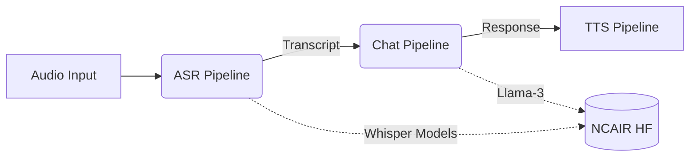

<div align="center">
  <h1>🌍 N-ATLAS SDK</h1>
  <p>Official Python SDK for N-ATLAS (Nigeria's multilingual LLM) and NCAIR Whisper ASR models.</p>
  
  [](https://www.python.org/downloads/)
  [](https://opensource.org/licenses/MIT)
  [](https://badge.fury.io/py/natlas-sdk)
</div>

## Description
The N-ATLAS SDK provides a seamless Python interface for interacting with the National Centre for Artificial Intelligence and Robotics (NCAIR) state-of-the-art multilingual LLM and Whisper ASR models. Designed for the NAIC 2026 hackathon, it enables developers to build voice-first, multi-lingual AI applications in Yoruba, Hausa, Igbo, and Nigerian-accented English.

## Installation

### pip install
```bash
pip install natlas-sdk
```

### From Source
```bash
git clone https://github.com/ncair/natlas-sdk.git
cd natlas-sdk
pip install -e .[all]
```

### Docker
```bash
docker-compose up --build
```

## Quickstart

```python
from natlas import NAtlasClient

client = NAtlasClient(hf_token="your_hf_token")
response = client.chat("Bawo ni?", language="yo")
print(response.text)
```

## Features
- 🗣️ **Multilingual Chat**: First-class support for Yoruba, Hausa, Igbo, and English via Llama-3 based N-ATLAS.
- 🎙️ **Speech-to-Text (ASR)**: Wraps 4 distinct NCAIR Whisper models for robust local transcription.
- 🚀 **Multiple Backends**: Run locally via Ollama (CPU/Mac friendly) or use Transformers on GPU.
- 🔌 **FastAPI Server**: Built-in OpenAI-compatible API server.
- 🛠️ **CLI Tool**: Powerful command-line interface for chat and transcription.

## Supported Languages

| Language | Code | ASR Model | LLM Support |
| -------- | ---- | --------- | ----------- |
| Hausa | `ha` | `NCAIR1/Hausa-ASR` | Yes |
| Yoruba | `yo` | `NCAIR1/Yoruba-ASR` | Yes |
| Igbo | `ig` | `NCAIR1/Igbo-ASR` | Yes |
| English (NG) | `en` | `NCAIR1/NigerianAccentedEnglish` | Yes |

## CLI Commands

- `natlas chat` - Interactive chat REPL. Example: `natlas chat --language yo`
- `natlas chat "message"` - One-shot chat message.
- `natlas transcribe file.wav` - Transcribe audio. Example: `natlas transcribe audio.wav --language ig`
- `natlas serve --port 8000` - Start the API server.
- `natlas models` - List all available models.

## API Server Endpoints

The built-in FastAPI server offers OpenAI-compatible endpoints:
- `POST /v1/chat/completions`: Chat completions API
- `POST /v1/audio/transcriptions`: Audio transcription API
- `GET /v1/models`: List available models
- `GET /health`: Health check

## Architecture


*Note: TTS Pipeline is planned for a future release.*

## Environment Variables

- `HF_TOKEN`: HuggingFace token for gated models
- `NATLAS_BACKEND`: Set to `transformers`, `ollama`, or `openai`
- `OLLAMA_BASE_URL`: Defaults to `http://localhost:11434`
- `OPENAI_API_KEY` / `OPENAI_BASE_URL`: For openai-compatible backend

## Troubleshooting

- **Models failing to load**: Ensure your `HF_TOKEN` is exported and you have accepted the model agreements on HuggingFace.
- **GPU out of memory**: Try using the `ollama` backend with GGUF models.

## Contributing
See [CONTRIBUTING.md](CONTRIBUTING.md) for details.

## License
MIT (Copyright 2026 NAIC Team)

## Credits
Models developed by NCAIR, NITDA, and Awarri AI.
