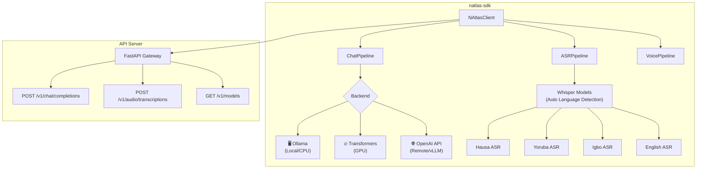

<div align="center">
  <h1>🌍 natlas-sdk</h1>
  <p><strong>The Python SDK for N-ATLAS — Nigeria's Open-Source Multilingual AI</strong></p>
  <p>Chat, transcribe, and build voice applications in Yoruba, Hausa, Igbo, and Nigerian English — in 3 lines of code.</p>
  
  [](https://www.python.org/downloads/)
  [](LICENSE)
  [](https://ncair.nitda.gov.ng/naic/)
</div>

---

## 🚀 What is this?

**natlas-sdk** is the missing developer toolkit for [N-ATLAS](https://huggingface.co/NCAIR1/N-ATLaS), Nigeria's sovereign multilingual LLM built by NCAIR/NITDA and Awarri Technologies. 

Today, every developer building on N-ATLAS writes the same boilerplate: loading models, formatting prompts, handling audio, managing backends. **natlas-sdk eliminates all of that.**

```python
from natlas import NAtlasClient

client = NAtlasClient()
response = client.chat("Bawo ni?", language="yo")
print(response.text)  # Response in Yoruba
```

### The Problem
- No official SDK exists for N-ATLAS
- Every hackathon team writes 200+ lines of boilerplate
- ASR models require manual pipeline setup for each of 4 languages
- No simple way to switch between GPU (Transformers), local (Ollama), or remote (API) backends

### The Solution
One package. Three lines of code. All 5 NCAIR models.

---

## ⚡ Quick Install

```bash
pip install -e .
```

Or with Docker:
```bash
docker-compose up
```

---

## 🎯 Features

| Feature | Description |
|---|---|
| 🗣️ **Multilingual Chat** | First-class support for Yoruba, Hausa, Igbo, and Nigerian-accented English |
| 🎙️ **Speech-to-Text** | Wraps all 4 NCAIR Whisper ASR models with auto language detection |
| 🔊 **Voice Pipeline** | End-to-end: Audio → Transcribe → Chat → Response |
| 🔌 **3 Backends** | Ollama (local/CPU), Transformers (GPU), OpenAI-compatible (remote/vLLM) |
| 🌐 **API Server** | Built-in FastAPI server with OpenAI-compatible endpoints |
| 💻 **CLI Tool** | `natlas chat`, `natlas transcribe`, `natlas serve` |
| 🐳 **Docker** | One-command deployment with `docker-compose up` |
| 📚 **Full Docs** | Quickstart, API reference, examples in all 4 languages |

---

## 🌐 Supported Languages

| Language | Code | LLM | ASR Model |
|---|---|---|---|
| 🟢 Hausa | `ha` | ✅ | `NCAIR1/Hausa-ASR` |
| 🟢 Yoruba | `yo` | ✅ | `NCAIR1/Yoruba-ASR` |
| 🟢 Igbo | `ig` | ✅ | `NCAIR1/Igbo-ASR` |
| 🟢 English (NG) | `en` | ✅ | `NCAIR1/NigerianAccentedEnglish` |

---

## 📖 Usage Examples

### Chat in Any Nigerian Language

```python
from natlas import NAtlasClient

client = NAtlasClient(backend="ollama")  # No GPU needed!

# English
print(client.chat("What crops grow best in Northern Nigeria?").text)

# Hausa
print(client.chat("Wane irin amfanin gona ne ya fi dacewa?", language="ha").text)

# Yoruba
print(client.chat("Kini awọn irugbin ti o dara julọ?", language="yo").text)

# Igbo
print(client.chat("Kedu ihe ọkụkụ kacha mma?", language="ig").text)
```

### Transcribe Audio

```python
# Transcribe Nigerian speech — auto-detects language
result = client.transcribe("farmer_question.wav")
print(f"Language: {result.language}")  # "ha"
print(f"Text: {result.text}")         # "Yaya zan magance cutar masara?"

# Or specify language explicitly
result = client.transcribe("audio.wav", language="yo")
```

### Full Voice Pipeline

```python
# Audio in → Transcribe → Chat → Response (one call!)
result = client.voice_pipeline("farmer_voice_note.wav")
print(f"Farmer said ({result.language}): {result.transcript}")
print(f"AI response: {result.response}")
```

### API Server (OpenAI-Compatible)

```bash
# Start the server
natlas serve --port 8000

# Then use from any OpenAI client
curl -X POST http://localhost:8000/v1/chat/completions \
  -H "Content-Type: application/json" \
  -d '{"model": "natlas", "messages": [{"role": "user", "content": "Sannu!"}]}'
```

---

## 💻 CLI Commands

```bash
# Interactive chat
natlas chat

# One-shot message
natlas chat "How do I plant cassava?"

# Chat in Hausa
natlas chat -l ha "Yaya zan shuka rogo?"

# Transcribe audio
natlas transcribe recording.wav

# Start API server
natlas serve --port 8000

# List available models
natlas models
```

---

## 🏗️ Architecture



---

## ⚙️ Configuration

### Environment Variables

| Variable | Description | Default |
|---|---|---|
| `HF_TOKEN` | HuggingFace access token (required for gated models) | — |
| `NATLAS_BACKEND` | Backend: `ollama`, `transformers`, `openai` | `ollama` |
| `OLLAMA_BASE_URL` | Ollama server URL | `http://localhost:11434` |
| `OLLAMA_MODEL` | Ollama model name | `natlas` |

### Backend Options

| Backend | GPU Required? | Best For |
|---|---|---|
| `ollama` | ❌ No | Local development, CPU/Mac, quick testing |
| `transformers` | ✅ Yes (16GB+ VRAM) | Production, maximum quality |
| `openai` | ❌ No (remote GPU) | Using vLLM server, Colab/Kaggle deployment |

---

## 🐳 Docker Deployment

```bash
# Start full stack (API server + Ollama)
docker-compose up -d

# The API server will be available at http://localhost:8000
```

---

## 📁 Project Structure

```
natlas-sdk/
├── natlas/
│   ├── __init__.py          # Package exports
│   ├── client.py            # Main NAtlasClient class
│   ├── chat.py              # Chat pipeline
│   ├── asr.py               # ASR transcription (all 4 Whisper models)
│   ├── pipeline.py          # Voice pipeline (audio → text → chat)
│   ├── language.py          # Language detection
│   ├── cli.py               # CLI tool
│   ├── server.py            # FastAPI server
│   └── backends/
│       ├── ollama.py        # Ollama backend
│       ├── transformers.py  # HuggingFace Transformers backend
│       └── openai_compat.py # OpenAI-compatible API backend
├── examples/                # Code examples in all 4 languages
├── docs/                    # Documentation
├── tests/                   # Unit tests
├── notebooks/               # Kaggle/Colab deployment notebooks
├── pyproject.toml
├── Dockerfile
├── docker-compose.yml
└── Makefile
```

---

## 🧪 Testing

```bash
# Run all tests
make test

# Or directly
python -m pytest tests/ -v
```

---

## 🤝 Contributing

We welcome contributions! See [CONTRIBUTING.md](CONTRIBUTING.md) for guidelines.

1. Fork the repository
2. Create a feature branch (`git checkout -b feature/amazing-feature`)
3. Commit your changes
4. Push to the branch
5. Open a Pull Request

---

## 📄 License

MIT License — see [LICENSE](LICENSE) for details.

---

## 🙏 Credits & Attribution

- **N-ATLAS** is an initiative of the **Federal Ministry of Communications, Innovation and Digital Economy (FMCIDE)**, powered by **Awarri Technologies**
- Models developed by the **National Centre for Artificial Intelligence and Robotics (NCAIR)**, a special-purpose vehicle of **NITDA**
- Built for the **National AI Innovation Challenge (NAIC) 2026**

> *N-ATLAS is an initiative of the Federal Ministry of Communications, Innovation and Digital Economy, and powered by Awarri Technologies.*
