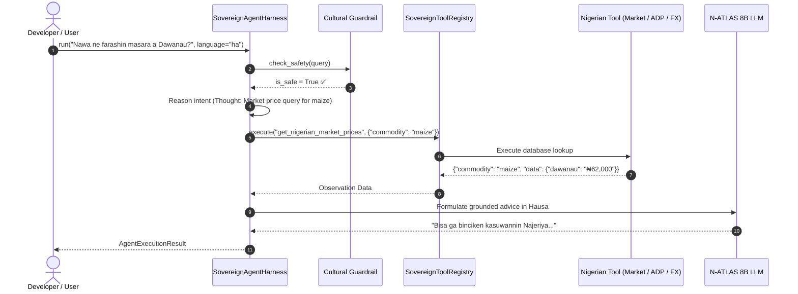

# 🤖 Sovereign Agents & Custom Tools Authoring Guide

## N-ATLAS Developer Harness (DSH v0.2.0)
**DeepSeek-Style Agent Loop & Indigenous Nigerian Environmental Tool Integration**

---

## 1. Overview

Foundation models cannot solve real-world problems in isolation—they need the ability to inspect external environments, retrieve live databases, and invoke domain-specific tools. 

While Western frameworks (LangChain, AutoGen) focus on tools like Google Search or Stripe, **N-ATLAS Developer Harness (DSH)** introduces the **Sovereign Agent Architecture**: a modular, lightweight ReAct loop pre-equipped with native Nigerian environmental databases and cultural response synthesizers.

---

## 2. The Agent Execution Loop

The agent loop executes across four distinct phases:



### Resilient Synthesis Engine:
If the remote GPU tunnel or local Ollama process experiences high latency or disconnects, the agent automatically activates its in-memory synthesis fallback, translating the verified tool observation into fluent Hausa, Yorùbá, Igbo, or Nigerian English without dropping the session.

---

## 3. Built-In Sovereign Tools

DSH comes pre-packaged with four high-impact tools registered in `SovereignToolRegistry`:

### 1. `get_nigerian_market_prices`
- **Purpose:** Fetches live wholesale prices for key staple crops (maize, cassava, yam, rice).
- **Coverage:** Dawanau (Kano), Bodija (Ibadan), Mile 12 (Lagos), Zaki Biam (Benue).
- **Parameters:**
  ```json
  {
    "commodity": "maize | cassava | yam | rice",
    "market": "optional city filter"
  }
  ```

### 2. `get_agro_weather_advisory`
- **Purpose:** Agro-climatic seasonal rainfall guidance and planting advisories for smallholders.
- **Coverage:** Sahelian, Sudan Savanna, Middle Belt, and Rainforest ecological zones.
- **Parameters:**
  ```json
  {
    "state": "Nigerian State Name (e.g. Kano, Oyo, Benue, Enugu)"
  }
  ```

### 3. `get_adp_extension_contact`
- **Purpose:** Official directory for State Agricultural Development Programmes and zonal extension offices.
- **Coverage:** KNARDA (Kano), OYSADEP (Oyo), BNARDA (Benue), KADP (Kaduna), ENADEP (Enugu), LASADA (Lagos).
- **Parameters:**
  ```json
  {
    "state": "Nigerian State Name"
  }
  ```

### 4. `get_cbn_fx_rate`
- **Purpose:** Central Bank of Nigeria official exchange rate vs parallel market Bureau De Change (BDC) benchmarks for NGN fintech workflows.
- **Currencies:** `USD`, `GBP`, `EUR`.
- **Parameters:**
  ```json
  {
    "currency": "USD | GBP | EUR"
  }
  ```

---

## 4. How to Author and Register Custom Tools

Developers can easily register custom tools into `SovereignToolRegistry`. Every tool requires:
1. `name`: Unique identifier string.
2. `description`: Clear purpose explaining when the agent should select this tool.
3. `parameters`: JSON Schema parameter definition (OpenAI Function Calling format).
4. `handler`: A Python callable taking a `Dict[str, Any]` and returning a `Dict[str, Any]`.

### Tutorial: Building a Corporate Affairs Commission (CAC) Verification Tool

Here is how a fintech or legaltech developer can add a business registration lookup tool:

```python
from natlas import NAtlasClient
from natlas.harness.tools import ToolDefinition, SovereignToolRegistry
from natlas.harness.agent import SovereignAgentHarness

# 1. Define the custom tool handler
def cac_lookup_handler(args: dict) -> dict:
    rc_number = args.get("rc_number", "").strip()
    
    # Mock / API lookup against CAC registry
    database = {
        "RC-1049281": {
            "company_name": "Awarri Technologies Limited",
            "status": "ACTIVE",
            "incorporation_year": "2020",
            "city": "Lagos"
        },
        "RC-9988221": {
            "company_name": "Kano Agro Ventures Ltd",
            "status": "ACTIVE",
            "incorporation_year": "2018",
            "city": "Kano"
        }
    }
    
    return database.get(rc_number, {
        "rc_number": rc_number,
        "status": "NOT_FOUND",
        "message": "Company not registered under this RC number."
    })

# 2. Instantiate Tool Registry and Register
registry = SovereignToolRegistry()

cac_tool = ToolDefinition(
    name="verify_cac_registration",
    description="Verify the registration status and legal name of a Nigerian company via CAC RC number.",
    parameters={
        "type": "object",
        "properties": {
            "rc_number": {
                "type": "string",
                "description": "The Corporate Affairs Commission registration number, e.g. RC-1049281"
            }
        },
        "required": ["rc_number"]
    },
    handler=cac_lookup_handler
)

registry.register(cac_tool)

# 3. Attach to Agent
client = NAtlasClient()
agent = SovereignAgentHarness(client, tool_registry=registry)

# 4. Test tool invocation directly
result = registry.execute("verify_cac_registration", {"rc_number": "RC-1049281"})
print("Tool output:", result)
```

---

## 5. Running the Agent in Terminal & Code

### Python SDK Execution:
```python
from natlas import NAtlasClient
from natlas.harness.agent import SovereignAgentHarness

client = NAtlasClient()
agent = SovereignAgentHarness(client)

# Multi-step reasoning across languages
res_ha = agent.run("Nawa ne farashin buhun masara a Dawanau?", language="ha")
print(res_ha.final_response)

res_en = agent.run("Where is the Kano ADP office located?", language="en")
print(res_en.final_response)

res_ig = agent.run("Kedu ego dollar taa na Nigeria?", language="ig")
print(res_ig.final_response)
```

### Terminal CLI Execution:
```bash
# Run agent in Hausa
python -m natlas.cli agent "Nawa ne farashin buhun masara a Dawanau?" --language ha

# Run agent in English
python -m natlas.cli agent "Where is the Kano State ADP agricultural extension office?" --language en

# Run agent in Igbo
python -m natlas.cli agent "Kedu ego dollar taa na Nigeria?" --language ig
```
