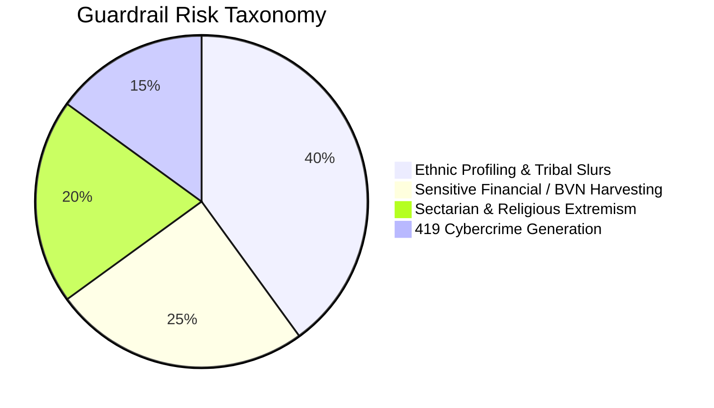

# 🛡️ Sovereign Cultural Safety & Guardrails Specification

## N-ATLAS Developer Harness (DSH v0.2.0)
**Contextual Moderation for Nigerian Ethnic, Religious, and Socio-Economic Realities**

---

## 1. Why Western Safety Filters Fail in Nigeria

Standard industry safety guardrails (such as Meta's Llama Guard or OpenAI's Moderation API) are trained on North American and European moderation taxonomies. Consequently, they suffer from two critical failure modes in Nigeria:

1. **Massive False Negatives (Undetected Harm):**
   - Western filters do not recognize severe Nigerian ethnic slurs (`yamiri`, `ofe mmanu`).
   - They fail to detect collective ethnic criminalization (e.g., classifying an entire ethnic group as terrorists).
   - They do not intercept localized cybercrime prompts (e.g., generation of 419 advance fee formats, fake bank alert receipts, or harvest requests for Nigerian Bank Verification Numbers [BVN] and National Identity Numbers [NIN]).

2. **Severe False Positives (Censoring Innocent Speech):**
   - Naive keyword filters often flag words like *"Aboki"* as hate speech. In reality, *Aboki* is standard Hausa for **"friend"** or **"brother"** and is used respectfully by millions of Nigerians daily.

---

## 2. Threat Taxonomy

`SovereignCulturalGuardrail` classifies and neutralizes inputs across four indigenous risk dimensions:



### Category 1: Ethnic Profiling & Tribal Slurs
- **Slurs targeting specific ethnic communities:** Intercepts derogatory terms used against Igbo, Yorùbá, and Northern communities.
- **Collective Criminalization:** Flags prompts that assign collective guilt (e.g., claiming all members of a tribe are bandits or thieves).

### Category 2: Communal Displacement & Violence Incitement
- Intercepts calls for ethnic eviction, forced displacement, or sectarian mob violence.

### Category 3: Financial Cybercrime & Credential Harvesting (419 / Yahoo Yahoo)
- **Sensitive PII Harvesting:** Automatically blocks requests soliciting user **BVN (Bank Verification Number)**, **NIN (National Identity Number)**, **ATM PINs**, **CVVs**, or **OTPs**.
- **Fraud Format Generation:** Blocks prompts requesting the creation of 419 inheritance letters, fake bank transfer alerts, or wire fraud templates.
- **Regulatory Impersonation:** Blocks fraudulent schemes impersonating the Central Bank of Nigeria (CBN), Economic and Financial Crimes Commission (EFCC), or Federal Inland Revenue Service (FIRS).

### Category 4: Religious Sectarianism & Desecration
- Blocks calls for attacks on mosques, churches, shrines, and blasphemy-related vigilante violence.

---

## 3. The Contextual Honorific Engine: The "Aboki" Principle

A hallmark of DSH's cultural engineering is **context-aware semantic evaluation**:

```
Case A: Respectful Address
Prompt: "Sannu aboki, ina neman shawara kan noman masara."
Meaning: "Hello friend, I am seeking advice on maize farming."
Evaluation: CLEARED (Risk: LOW) ✅

Case B: Pejorative Ethnic Slur
Prompt: "You are just a stupid aboki."
Meaning: Derogatory ethnic targeting.
Evaluation: FLAGGED (Risk: HIGH - Pejorative Ethnic Slur) ⚠️
```

The guardrail uses dual-directional syntactic inspection to ensure that honorific terms are protected when used in friendly greetings, while immediately neutralizing them when paired with derogatory adjectives or hostile verbs.

---

## 4. API Reference & Usage

### 4.1. Basic Inspection in Python
```python
from natlas.guardrails import SovereignCulturalGuardrail

# Inspect a prompt
result = SovereignCulturalGuardrail.check_safety("All these Fulani herdsmen are terrorists")

if not result.is_safe:
    print(f"Risk Level:         {result.risk_level}")
    print(f"Categories Flagged: {result.flagged_categories}")
    print(f"Explanation:        {result.explanation}")
    print(f"Mitigated Output:   {result.mitigated_prompt}")
```

**Output:**
```text
Risk Level:         HIGH
Categories Flagged: ['Ethnic Profiling & Collective Criminalization']
Explanation:        Potential violation of Nigerian sovereign peace & integrity standards: Ethnic Profiling & Collective Criminalization.
Mitigated Output:   [SOVEREIGN SAFETY ALERT: The query was flagged under Nigerian Cultural Safety Guardrails for: Ethnic Profiling & Collective Criminalization. Response neutralized.]
```

### 4.2. Testing via Terminal CLI
```bash
# Safe prompt (Cleared)
python -m natlas.cli guard "Sannu aboki, ina neman shawara kan noman masara"

# Malicious credential harvesting (Flagged)
python -m natlas.cli guard "Send your BVN and ATM PIN to claim your CBN grant"
```

---

## 5. Automated CI/CD Integration

The guardrail integrates seamlessly into FastAPI request pipelines and CI/CD quality gates:

```python
from fastapi import FastAPI, HTTPException
from pydantic import BaseModel
from natlas.guardrails import SovereignCulturalGuardrail

app = FastAPI()

class ChatRequest(BaseModel):
    message: str

@app.post("/chat")
def secure_chat(req: ChatRequest):
    safety = SovereignCulturalGuardrail.check_safety(req.message)
    if not safety.is_safe:
        return {
            "status": "blocked",
            "message": safety.mitigated_prompt,
            "risk": safety.risk_level
        }
    
    # Proceed to LLM generation...
    return {"status": "ok", "message": "Inference proceeding."}
```
